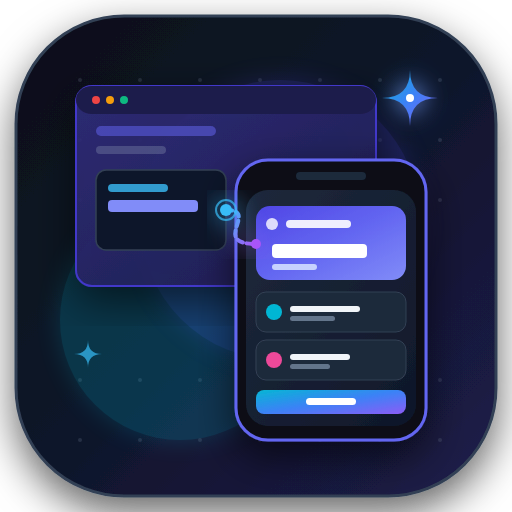
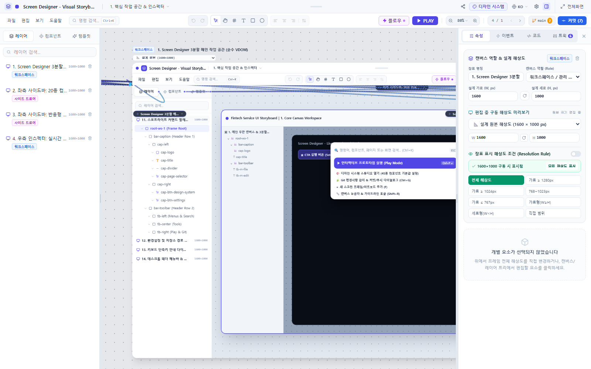

<p align="center">
  
</p>

<h1 align="center">Screen Designer</h1>

<p align="center">
  <strong>Universal Cross-Agent Visual Storyboard Canvas, MCP Suite & Headless CLI</strong><br>
  Claude Code、Cursor、OpenAI Codex/GPT、Google Gemini (Antigravity) のためのリアルタイムUIデザイン＆ビジュアルプロトタイピングツール
</p>

<p align="center">
  <a href="README.en.md">English</a> • <a href="README.md">한국어</a> • <a href="README.ja.md">日本語</a>
</p>

<p align="center">
  <a href="https://www.npmjs.com/"></a>
  <a href="https://modelcontextprotocol.io/"></a>
  <a href="LICENSE"></a>
  <a href="docs/ja/features.md#13-多言語対応-i18n"></a>
</p>

---



---

## 🌟 主な特徴 (Key Features)

1. **リアルタイムレンダリング＆無限キャンバス (Live Canvas)**:
   - AIエージェントからコードを受信すると、インタラクティブなVDOM UIがキャンバスへ即時レンダリングされます。
   - レイヤーツリーDOM最適化と、window-level rAFによる60FPSのパン＆ズームエンジンを搭載。
2. **📐 キャンバス役割(Role)＆レスポンシブ解像度システム**:
   - 固定のデバイス規格ではなく、画面の目的や役割（`main-page`、`sub-page`、`modal`、`bottom-sheet`、`widget`、`responsive-viewport`）に基づいてフレームを設計します。
   - 幅×高さの直接入力、ワンクリック向き切り替え、編集中リアルタイム稼働プリセットプレビュー、解像度別の条件付き表示ルール(Resolution Rules)に対応。
3. **⚡ インタラクティブプロトタイピング＆動的調整 (Events & Tweaks)**:
   - Figmaスタイルのベジェ曲線フローライン(Wires)、実機モックアップ再生モード(`▶ PLAY`)、クリックホットスポットガイド。
   - テーマ(Dark/Light/Cyber)、通貨・金額(₩/$/€/¥)、言語、UI密度などを調整すると、VDOMモックアップが動的に更新されます。
4. **🛠️ 17種のドメイン指向MCPツール (`screen_designer_*`)**:
   - プロジェクト参照からページ・アートボード生成、ノードスタイル変更、デザインシステムトークン管理、Chrome Headlessによるビジュアル検証ツールを標準MCPプロトコルで提供。
5. **💻 CLI制御インターフェース (`screen-designer`)**:
   - ターミナルから `screen-designer page create`、`screen-designer artboard add/update/delete`、`screen-designer commit` などのサブコマンドでプロジェクトを操作可能。
6. **📦 ネイティブGitエンジン (`es-git`) 統合**:
   - 外部Gitバイナリ不要。組み込みの `es-git` エンジンが変更を検知し、差分(diff)確認からコミット／プッシュまでをサポート。
7. **🌐 3言語多言語対応 (i18n)**:
   - 日本語(`ja`)、韓国語(`ko`)、英語(`en`)の言語切り替え、およびプロジェクト単位の永続保存に対応。

---

## 🚀 クイックスタート (Getting Started)

### 1. グローバルインストール

```bash
# npm経由でグローバルCLIをインストール
npm install -g screen-designer

# 任意の対象プロジェクトを指定して直接起動
screen-designer /path/to/my-project
```

### 2. プロジェクト初期化 (Project Init)

既存のプロジェクトディレクトリでコマンド1行を実行するだけで連携環境を構築できます:

```bash
npx screen-designer init
```

実行後、以下のファイル群が自動生成されます:
- `.screen-designer/config.json`: プロジェクト設定（ページ保存先、デザインシステムパスなど）
- `docs/ui-boards/`: UI絵コンテ保存先（`project.json`、`design-system.json`、`pages/`、`assets/`）
- `AGENTS.md` & `CLAUDE.md`: AIコーディングエージェント向け指示書

### 3. MCPサーバーおよびUI起動

```bash
# MCP標準I/Oサーバー起動（AIエージェント連携用）
screen-designer serve
# または
screen-designer mcp

# Web/デスクトップ キャンバスUI起動
screen-designer ui
```

---

## ⌨️ CLIコマンドリファレンス (CLI Reference)

Screen Designerが提供する主なCLIコマンドです:

```bash
# 状態確認＆診断
screen-designer status                          # プロジェクト状態およびページ一覧確認
screen-designer doctor                          # 環境および依存関係の正常性チェック

# ページ管理
screen-designer page list                       # 登録済み全ページ一覧表示
screen-designer page create "決済フロー"         # 新規ページの作成

# アートボード管理
screen-designer artboard list <pageId>          # ページ内アートボード一覧確認
screen-designer artboard add <pageId> -t "ログイン" --viewport mobile
screen-designer artboard update <pageId> <artboardId> --title "ログイン V2"
screen-designer artboard delete <pageId> <artboardId>

# デザイントークン＆コード出力
screen-designer tokens get                      # デザインシステムトークン取得
screen-designer tokens set --primary "#4f46e5"  # ブランドプライマリカラー変更
screen-designer export <artboardId> -o ./src    # React + Tailwindコンポーネントとして出力
screen-designer render-image <pageId>           # Chrome Headlessでアートボード画像キャプチャ

# Gitデスクトップバージョン管理
screen-designer commit -m "feat: 決済フローアートボード追加"
```

---

## 🔌 提供MCPツール一覧 (17種)

Screen Designer MCPサーバーは、`screen_designer_*` 標準名前空間および互換エイリアスをサポートしています:

| カテゴリ | ツール名 | 説明 |
| :--- | :--- | :--- |
| **Project** | `screen_designer_get_project` | プロジェクト設定、キャンバス接続状態、全ページ一覧取得 |
| **Pages** | `screen_designer_list_pages` | UI画面ページ一覧およびメタデータ要約の取得 |
| | `screen_designer_get_page` | 特定ページの全アートボード、VDOMノードツリー、ワイヤー、調整値の取得 |
| | `screen_designer_create_page` | 新規ページ作成（テンプレートや初期アートボード指定可能） |
| | `screen_designer_save_page` | 仮想DOMページドキュメントの保存・更新 (`docs/ui-boards/pages/*.json`) |
| | `screen_designer_delete_page` | ページドキュメント削除およびマニフェスト同期 |
| **Artboards** | `screen_designer_add_artboard` | ページへ新規アートボード（モバイル/デスクトップ/テンプレート）追加 |
| | `screen_designer_update_artboard` | 特定アートボードのメタデータ、VDOMノードツリー、スタイルの部分更新 |
| | `screen_designer_delete_artboard` | 特定アートボードの削除（キャンバス、レイヤー、プロパティ、ショートカット連動） |
| **Tokens** | `screen_designer_get_design_system` | デザインシステムトークンおよびコンポーネント初期スタイルの取得 |
| | `screen_designer_save_design_system` | デザイントークン・初期スタイルの一括更新およびキャンバス同期 |
| **Live Canvas**| `screen_designer_get_live_selection` | キャンバス上で選択中の要素IDおよびスライダー調整値の取得 |
| | `screen_designer_sync_canvas` | キャンバスのズーム/パン移動、特定アートボード/要素へのカメラフォーカス |
| **Visual & Code**| `screen_designer_render_image` | Chrome Headlessによる高解像度画像キャプチャ（ビジュアル検証用） |
| | `screen_designer_export_code` | VDOM構造から本番対応React 19 + Tailwind CSSコードを自動生成 |
| **Git** | `screen_designer_git_status` | `es-git` によるUI変更ファイルのステージング状態およびdiff取得 |
| | `screen_designer_git_commit` | `es-git` によるUI変更履歴の自動ステージングおよびコミット作成 |

---

## 💬 AIエージェント向けプロンプト活用例

### 1. Google Gemini (Antigravity)
```text
"Gemini、screen_designer_create_pageで「会員登録フロー」ページを作成し、モバイル向けオンボーディング画面を3つ横並びで追加して"
```

### 2. Anthropic Claude (Claude Code / Desktop)
```text
"Inspect the active page with screen_designer_get_page, change the button color to #6366f1 using screen_designer_update_artboard, and verify the screenshot with screen_designer_render_image."
```

### 3. OpenAI GPT / Codex
```text
"デザインシステムトークンをダークサイバーパンクテーマに更新して、修正されたUI変更をes-gitでコミットして"
```

---

## 📚 ドキュメント一覧 (Documentation Hub)

詳細仕様およびガイドは [docs/ja/](docs/ja/README.md) ディレクトリでご確認いただけます:

- 📖 [ドキュメントハブ (docs/ja/README.md)](docs/ja/README.md)
- 📋 [実装機能詳細仕様書 (features.md)](docs/ja/features.md)
- 🛠️ [MCPツール＆CLIリファレンス (mcp-and-cli-reference.md)](docs/ja/mcp-and-cli-reference.md)
- 📁 [プロジェクト保存構造仕様書 (project-structure.md)](docs/ja/project-structure.md)
- 🌐 [グローバルインストール＆ターゲット実行設計書 (global-install-and-target-execution.md)](docs/ja/global-install-and-target-execution.md)
- ⌨️ [ショートカット＆生産性ガイド (shortcuts.md)](docs/ja/shortcuts.md)
- 🤖 [エージェント開発・保守マニュアル (AGENTS.md)](AGENTS.md)

---

## 💻 ローカル開発および貢献 (Development)

```bash
# 1. 依存関係のインストール
npm install

# 2. 全パッケージのビルド (packages/app, packages/mcp-server, packages/cli)
npm run build

# 3. ブラウザ開発サーバー起動 (Vite)
npm run dev:app

# 4. Electronデスクトップアプリ起動
npm run start

# 5. MCPサーバー単体起動
npm run dev:mcp
```

---

## 📄 ライセンス (License)

MIT License © 2026 jay94ks@gmail.com
