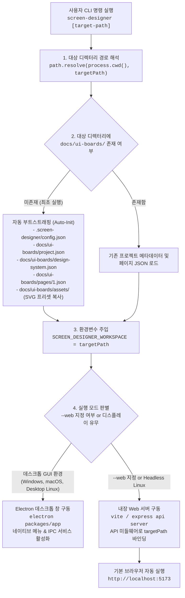

# 전역 설치 및 특정 프로젝트 대상 실행 설계서 (Global Installation & Target Execution Architecture)

본 문서는 **Screen Designer**를 전역(Global) 도구로 설치하고, 임의의 특정 대상 프로젝트(Target Project) 경로를 지정하여 스토리보드 캔버스를 즉각 구동하고 관리할 수 있도록 하는 아키텍처 및 CLI 설계를 정의합니다.

---

## 1. 개요 및 설계 목표

### 1.1 해결하고자 하는 문제
- 지금까지는 `screen-designer` 저장소 자체의 내부 디렉터리에서만 앱을 구동할 수 있었습니다.
- 실제 사용자는 자신의 기존 프로젝트(예: `C:\workspace\my-fintech-app`, `/home/user/nextjs-shopping-mall`) 어디서나 단 한 줄의 터미널 명령으로 스토리보드 기획 캔버스를 띄우고, 해당 프로젝트 내부에 `docs/ui-boards/` 구조를 생성·관리하길 원합니다.

### 1.2 핵심 설계 원칙
1. **Zero-Config 원클릭 실행**: 복잡한 설정 없이 `screen-designer [경로]` 입력만으로 즉각 구동.
2. **전역 설치 및 무설치(npx) 완벽 지원**:
   - `npm install -g screen-designer`
   - `npx screen-designer [target-path]`
3. **지능형 환경 적응 (Electron Desktop vs Web Mode)**:
   - 디스플레이가 지원되는 일반 데스크톱(Windows, macOS, 데스크톱 Linux)에서는 네이티브 **Electron 창** 구동.
   - GUI 디스플레이가 없는 환경(WSL2 터미널, 원격 서버, Linux 콘솔) 또는 `--web` 플래그 사용 시 **로컬 웹 서버 + 브라우저 자동 오픈**으로 스마트 폴백.
4. **프로젝트 자동 감지 및 부트스트래핑 (Auto-Scaffolding)**:
   - 대상 프로젝트에 `docs/ui-boards/`가 없으면 최신 규격(`project.json`, `design-system.json`, `pages/1.json`, `assets/`)으로 즉시 자동 초기화.
   - 이미 존재하는 경우 기존 기획 보드 데이터를 그대로 로드.

---

## 2. CLI 명령어 및 옵션 명세 (CLI Specification)

### 2.1 기본 명령어 형식
```bash
screen-designer [target-path] [options]
```

### 2.2 사용 예시 (Usage Examples)

```bash
# 1. 현재 디렉터리를 대상으로 실행
screen-designer .

# 2. 특정 프로젝트 경로를 대상으로 실행
screen-designer /home/jay94ks/projects/e-commerce-app
screen-designer C:\Projects\FintechMobileApp

# 3. 경로를 생략하면 현재 디렉터리(.)를 기본 대상으로 실행
screen-designer

# 4. 웹 브라우저 모드로 강제 실행
screen-designer . --web

# 5. 웹 모드 포트 지정 및 브라우저 자동 오픈 끄기
screen-designer . --web --port=3000 --no-open

# 6. GUI를 띄우지 않고 대상 프로젝트에 디렉터리 구조만 초기화
screen-designer . --init
# 또는
screen-designer init ./my-new-app

# 7. 대상 프로젝트의 기획 데이터를 기반으로 React/Vue 코드 생성
screen-designer export --workspace=./my-app --format=react --out=src/components

# 8. 대상 프로젝트의 특정 화면을 이미지(PNG)로 즉시 렌더링
screen-designer render-image page-1 screen-1-main --workspace=./my-app
```

### 2.3 옵션 및 플래그 목록

| 플래그 | 별칭 | 기본값 | 설명 |
| :--- | :---: | :---: | :--- |
| `[target-path]` | - | `.` (현재 폴더) | 작업 대상 프로젝트의 디렉터리 경로 (상대/절대 경로 모두 지원) |
| `--web` | `-w` | `false` | Electron 대신 로컬 웹 서버 및 기본 웹 브라우저로 실행 |
| `--port <num>` | `-p` | `5173` | 웹 서버 모드 실행 시 바인딩할 포트 번호 |
| `--host <ip>` | - | `0.0.0.0` | 웹 서버 호스트 주소 (외부 기기 접속 지원) |
| `--no-open` | - | `false` | 서버 구동 시 기본 웹 브라우저 자동 실행 생략 |
| `--init` | `-i` | `false` | GUI를 실행하지 않고 기본 `docs/ui-boards` 파일 구조만 생성 |
| `--help` | `-h` | - | 명령어 도움말 출력 |
| `--version` | `-v` | - | Screen Designer 버전 정보 출력 |

---

## 3. 프로젝트 라이프사이클 및 실행 흐름



---

## 4. 핵심 내부 아키텍처 구현

### 4.1 대상 프로젝트 경로 주입 메커니즘
Screen Designer의 모든 데이터 서비스(파일 I/O, Git 제어, 에셋 서빙)는 **`SCREEN_DESIGNER_WORKSPACE`** 환경변수를 최우선 참조합니다.

```typescript
// packages/app/electron/assetService.ts
export function resolveProjectRoot(workspacePath?: string): string {
  if (workspacePath && workspacePath !== '.') {
    return workspacePath;
  }
  // CLI가 주입한 대상 프로젝트 절대 경로
  if (process.env.SCREEN_DESIGNER_WORKSPACE) {
    return process.env.SCREEN_DESIGNER_WORKSPACE;
  }
  return process.cwd();
}
```

### 4.2 웹 API 미들웨어의 타깃 프로젝트 바인딩
웹 브라우저 모드로 동작할 때도 모든 API(`save-project`, `load-project`, `git`, `assets`)가 `SCREEN_DESIGNER_WORKSPACE` 디렉터리를 대상으로 작동합니다:

```typescript
// packages/app/vite.config.ts
const targetRoot = process.env.SCREEN_DESIGNER_WORKSPACE || path.resolve(__dirname, '../../');

// 1. 에셋 정적 서빙
const primaryPath = path.join(targetRoot, 'docs/ui-boards/assets', cleanUrl);

// 2. 프로젝트 파일 저장/로드
const data = await loadProjectStructure({ workspacePath: targetRoot });
```

### 4.3 크로스 플랫폼 브라우저 자동 오픈 로직
```typescript
function openBrowser(url: string) {
  const platform = process.platform;
  try {
    if (platform === 'win32') {
      execSync(`start "" "${url}"`);
    } else if (platform === 'darwin') {
      execSync(`open "${url}"`);
    } else {
      // WSL 환경 감지: Windows 기본 브라우저 호출
      const isWsl = fs.existsSync('/proc/version') && 
                    fs.readFileSync('/proc/version', 'utf8').toLowerCase().includes('microsoft');
      if (isWsl) {
        execSync(`cmd.exe /c start "${url}" 2>/dev/null || xdg-open "${url}"`);
      } else {
        execSync(`xdg-open "${url}" 2>/dev/null`);
      }
    }
  } catch {
    console.log(`\n👉 브라우저를 열어 다음 주소로 접속하세요: ${url}\n`);
  }
}
```

---

## 5. NPM 패키징 및 배포 구조 (NPM Distribution)

### 5.1 루트 및 패키지 `bin` 매핑
- **`package.json` (Monorepo 루트)**:
  ```json
  {
    "name": "screen-designer",
    "version": "0.1.0",
    "bin": {
      "screen-designer": "./packages/cli/bin/index.js"
    }
  }
  ```
- **`packages/cli/package.json`**:
  ```json
  {
    "name": "@screen-designer/cli",
    "version": "0.1.0",
    "bin": {
      "screen-designer": "./bin/index.js"
    }
  }
  ```

### 5.2 로컬 개발 환경에서 전역 도구로 등록하기 (`npm link`)
개발 중인 컴퓨터에서 전역 명령어로 즉시 테스트하려면:

```bash
# 1. 빌드 완료
npm run build

# 2. 전역 심볼릭 링크 생성 (루트 또는 packages/cli에서 실행)
cd /home/jay94ks/screen-designer
npm link

# 3. 이제 임의의 폴더로 이동하여 실행 테스트
cd ~/my-test-project
screen-designer .
```

### 5.3 NPM 배포 후 최종 사용자 경험
배포가 완료되면 전 세계 개발자들은 추가 설정 없이 바로 실행할 수 있습니다:

```bash
# 옵션 A: 전역 설치
npm install -g screen-designer
screen-designer ./my-react-app

# 옵션 B: 설치 없이 1회성 즉시 실행
npx screen-designer ./my-react-app
```

---

## 6. 사용 시나리오 예시

### 시나리오 1: 신규 웹 서비스 기획 시작
1. 개발자/기획자가 빈 폴더 `mkdir my-startup && cd my-startup` 생성.
2. `screen-designer .` 실행.
3. 자동으로 `docs/ui-boards/`가 생겨나며 스토리보드 캔버스가 화면에 표시됨.
4. 캔버스에서 화면들을 설계하고 기획 완료.

### 시나리오 2: 기존 Next.js 프로젝트에 스토리보드 추가
1. 기존 프로젝트 디렉터리로 이동: `cd ~/work/fintech-nextjs`.
2. `screen-designer .` 실행.
3. 프로젝트 내에 `docs/ui-boards/`가 추가되고, 상단 `[코드 내보내기]`를 통해 기획한 UI를 `src/components/`로 즉시 React 코드로 반영.
4. Git 뷰에서 `docs/ui-boards/` 파일만 깔끔하게 스테이징되어 커밋 관리.
